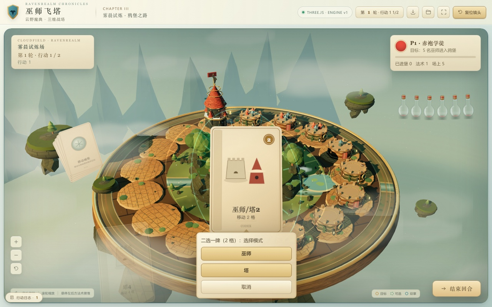

# 巫师飞塔 · 云野魔典

**The Wandering Towers — 标准版数字桌游实现**

规则引擎与渲染层彻底分离的双人本地对局项目：纯 TypeScript 规则内核 + Three.js 三维舞台 + 羊皮纸 HUD。
支持完整出牌流程、四种法术、药水系统、对局回放，以及一套用 Z 轴表达信息层级的交互界面。


---

## 这是什么

一个可以直接在浏览器里玩完一局《巫师飞塔》的本地实现。棋盘是浮空岛，塔是可叠放的立体棋子，
巫师站在塔顶，鸦堡在中央 —— 全部由 Three.js 实时渲染，没有预制 3D 模型，几何与贴图都是程序化生成的。

- **规则完整**：出牌、掷骰、移动巫师/塔、封印与解封、四种法术、药水补充、终局比较，全部按标准版实现
- **引擎纯逻辑**：`@wt/engine` 不依赖 DOM、不依赖渲染，可单独测试与复用
- **界面纵深**：手牌在前景、法术在左后方、主卡在选目标时主动让位，用景深而不是侧边栏组织信息
- **可回放**：导出对局 JSON、载入后按事件逐步重演
- **双端可跑**：macOS 与 Windows 使用同一套命令、同一份锁文件

## 界面速览

| 出牌第一步：选牌与选模式 | 第三步：选目标（主卡让位） |
| --- | --- |
|  |  |
| 点击手牌后主卡抬升至画面中央，正下方浮层给出「巫师 / 塔」二选一，不离开视线。 | 进入选目标后主卡退到左下并缩小，浮层横贴其右侧，棋盘中部完全留给点选。 |

界面分区（无侧边栏，全部融入舞台）：

| 位置 | 内容 |
| --- | --- |
| 左上 | 地点铭牌 + 第 N 轮 · 行动 N / 2 + 当前阶段 |
| 顶部居中 | 操作提示、错误提示、弃牌重抽入口 |
| 右上 | 玩家状态卡（色点、玩家名、进堡进度、法术/场上/封印计数） |
| 右上状态卡下方 | 6 只漂浮魔法瓶（满 / 空 / 已耗三态，玻璃通透、液体有光泽） |
| 底部中央 | 3 张手牌（前景）；左后方为法术牌堆，悬停即召至前景展开 |
| 左下 / 右下 | 相机控制与操作图例 / 结束回合 |

## 玩法与交互要点

**出牌是三步，视线只向下或向右移动**

1. 点击手牌 → 主卡抬升，浮层出现在卡牌正下方
2. 选择「巫师 / 塔」（二选一牌）或直接掷骰（骰子牌）
3. 在棋盘上点目标 → 浮层保持贴卡，取消或完成后卡牌沿原路径归位

**骰点掷出即锁定**

骰子牌一旦掷出，点数就写进 UI 层的锁定表：取消、改选别的牌、结束回合都会被拒绝，
必须点一个巫师/塔完成移动，或用「直接打出（放弃移动）」消耗本次行动。
后者不修改规则 —— 引擎对「非法目标」的既有处理就是消耗行动，界面只是给了一个必然走到的出口。

**法术牌堆的纵深交换**

左后方是一摞符文卡。鼠标悬停时四张依次飞到前景展开，同时三张手牌反向收拢成摞；
移开 0.5 秒后自动收回。四张符文卡的尺寸、文字与就绪状态都在 3D 卡面上绘制。

**魔法瓶**

6 只圆肚细颈药剂瓶，按 NDC 排在右上状态卡下方，随相机轻微视差浮动。三态画法不同：
满瓶有液面、气泡与竖向高光；空瓶只剩玻璃，能透出背后的浮空岛；已耗的木塞歪斜并带裂纹。

## 技术架构

```
wandering-towers/
├─ packages/
│  ├─ shared/    类型、枚举、地图、牌库、法术定义（前后端共享）
│  ├─ engine/    规则引擎：纯函数式状态机 + 命令校验 + 事件流，无 IO / 无 DOM
│  ├─ server/    权威服务端（Phase 5 联机占位）
│  └─ client/    React 18 + Vite + Three.js（唯一主线前端）
├─ docs/         设计文档、开发日志、可运行原型、素材与截图
└─ archive/      仅保留一份说明：第一版实现已从仓库移除（见文末）
```

依赖方向严格单向：`client → engine → shared`，`server → engine → shared`。
渲染层改造（Three.js 舞台、纵深卡牌、漂浮药水）没有触碰引擎一行代码，89 例引擎测试始终全绿。

**渲染分层**

| 层 | 内容 | 实现 |
| --- | --- | --- |
| 场景层 | 浮空岛、塔、巫师、鸦堡、云雾 | Three.js 实体几何 + Canvas 程序化贴图 |
| 卡牌层 | 手牌、法术牌堆、漂浮药水、粒子 | 独立透明 WebGL 画布（`.card-layer-canvas`），关闭色调映射，保证 UI 颜色不被场景曝光改变 |
| HUD 层 | 铭牌、状态卡、提示、结束回合 | DOM + CSS，羊皮纸与金饰令牌 |

**纵深槽位**

手牌 / 主卡 / 选目标 / 法术牌堆 / 法术展开各有固定 NDC 槽位与相机距离，
补间动画在槽位之间插值，因此任意分辨率下都不会飞出画面；鼠标命中只检测卡面本身，
魔法阵与光晕只作视觉，不会挡住对棋盘目标的点击。

## 快速开始

**环境要求**

| 项 | 版本 |
| --- | --- |
| Node.js | ≥ 20（推荐 22 LTS） |
| pnpm | 9.15.0（`packageManager` 已锁定） |

```bash
git clone https://github.com/LucasTseng/wandering-towers.git
cd wandering-towers/wandering-towers
pnpm install
pnpm dev
```

打开 http://localhost:8008 即可开始对局。

> 注意：仓库根目录下还有一层 `wandering-towers/`，所有命令都在内层目录执行。

### macOS

```bash
pnpm install
pnpm dev
```

### Windows

```powershell
# PowerShell 或 Windows Terminal 均可
node -v          # 需 >= 20
pnpm -v          # 需 9.15.0；未安装可 npm i -g pnpm@9.15.0
pnpm install
pnpm dev
```

Windows 相关说明：

- 仓库内已放 `.npmrc`（`node-linker=hoisted`），Windows 与 macOS 安装结果一致；
  同时 `package.json` 的 `supportedArchitectures` 覆盖 `win32`，锁文件带有 Windows 版 esbuild / rollup 二进制
- **不要从另一台机器拷贝 `node_modules`**：里面是平台相关的原生二进制，跨平台复用会失败；换机只需重新 `pnpm install`
- 若项目路径很深（例如放在多层 OneDrive 目录下），建议放到 `C:\dev\wandering-towers` 这类短路径，避免 Windows 260 字符路径限制
- 仓库统一使用 LF 行尾（`.gitattributes` 已配置），Windows 上无需额外处理

### 构建与预览

```bash
pnpm build                                   # 全仓构建（client 产出 dist/）
pnpm --filter @wt/client preview             # 本地预览生产包
```

## 常用脚本

| 命令 | 作用 |
| --- | --- |
| `pnpm dev` | 启动前端开发服务器（8008，热更新） |
| `pnpm build` | 全仓构建：shared → engine → server → client |
| `pnpm typecheck` | 全仓 TypeScript 检查 |
| `pnpm test` | Vitest 全量测试（8 个文件 / 89 例） |
| `pnpm test:engine` | 只跑规则引擎测试 |
| `pnpm replay:check` | 随机对局回放一致性检查 |
| `pnpm lint` | ESLint（0 error） |
| `pnpm format` | Prettier 格式化 |

开发期界面预览参数（仅 DEV 生效，直接拼在地址后）：

| 参数 | 效果 |
| --- | --- |
| `?uipreview=card` | 自动选中第一张手牌，查看贴卡浮层 |
| `?uipreview=card2` | 选中二选一牌，查看「巫师 / 塔」两按钮 |
| `?uipreview=target` | 进入选目标态，查看主卡让位布局 |
| `?uipreview=spell` | 直接展开法术牌堆 |
| `?uipreview=potion` | 伪造 3 满 / 2 空 / 1 已耗，查看药水三态 |

## 文档

文档体系从 [`wandering-towers/docs/README.md`](wandering-towers/docs/README.md) 进入。几个关键入口：

| 文档 | 内容 |
| --- | --- |
| [开发设计文档-架构与实现基线](wandering-towers/docs/开发设计文档-架构与实现基线.md) | 单一事实来源：架构、状态机、交互、变更记录 |
| [08-UI纵深交互方案](wandering-towers/docs/architecture/08-UI纵深交互方案.md) | Z 轴五层、卡下浮层、法术牌堆交换、实施记录与已知限制 |
| [00-开发任务总表](wandering-towers/docs/00-开发任务总表.md) | Phase 0–4 任务分解与 DoD |
| [dev-log](wandering-towers/docs/dev-log/) | 逐阶段开发日志（含踩坑记录） |
| [prototypes/depth-ui-demo.html](wandering-towers/docs/prototypes/depth-ui-demo.html) | 纵深交互原型（单文件，无规则，仅动画） |

## 项目状态

| 阶段 | 内容 | 状态 |
| --- | --- | --- |
| Phase 0–4 | 规则引擎、静态定义、本地双人对局、回放、三维舞台 | 已完成 |
| Phase U（P1–P3） | 纵深卡牌、贴卡浮层、法术牌堆、拆除侧栏、漂浮药水 | 已完成 |
| Phase U（TU.4） | 键盘/读屏可达性、窄屏降级布局 | 待做 |
| Phase 5 | 服务端权威联机 | 占位，按需推进 |

质量基线：`typecheck` / `build` / `lint` 全绿，引擎测试 8 文件 89 例通过。

## 版本说明

- **当前主线**：`packages/client`（Three.js 三维版），2026-11-24 起为唯一前端。
- **第一版（CSS 3D Transforms）**：曾以 `archive/v1-css3d-client` 形式保留，现已**从仓库中移除**，
  以保持仓库只包含可维护的主线代码。需要查阅或复跑时，从历史提交取回：

  ```bash
  git checkout 0510757 -- wandering-towers/archive/v1-css3d-client
  ```

  该提交是移除前的最后一次快照；取回后需手动把它加入 `pnpm-workspace.yaml` 才能安装依赖。
  两版的差异与取舍见 [wandering-towers/archive/README.md](wandering-towers/archive/README.md)。

## 说明

- 美术全部为程序化生成；石材贴图为 CC0 素材，位于 `packages/client/public/textures/`
- 仓库根目录的 6 份 V2/V3/V4 历史文档是项目早期的规则与需求快照，仅作参考，不随代码维护
- 本项目为个人自用的数字化实现，未获授权分发原始桌游素材
